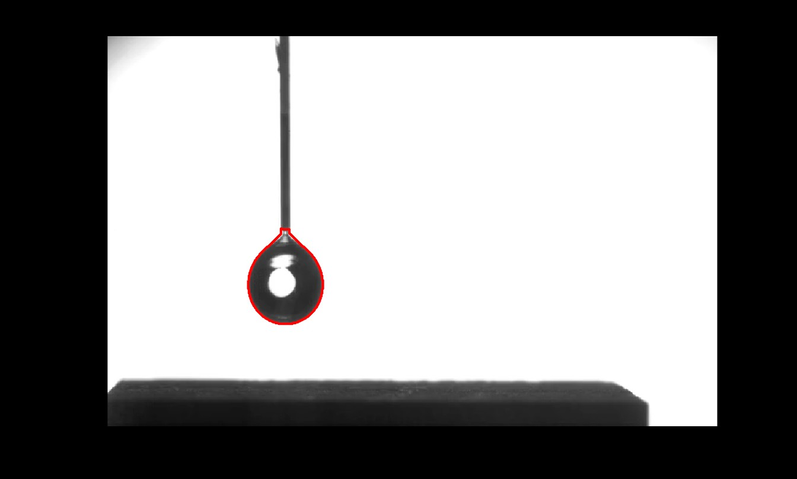
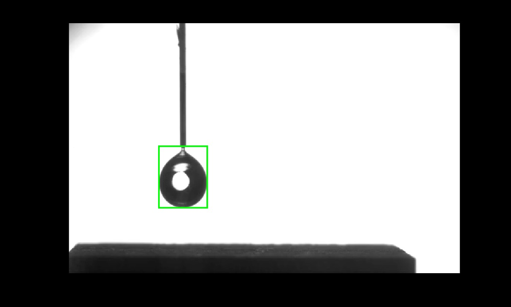
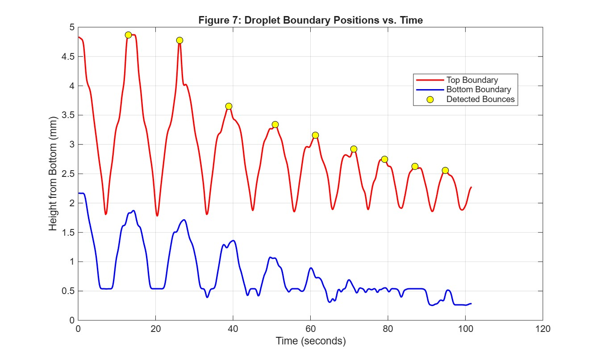
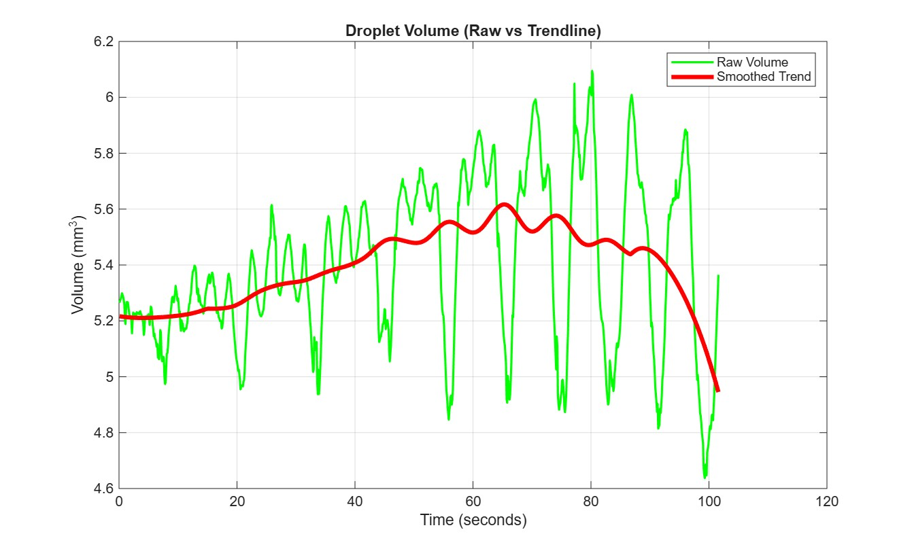
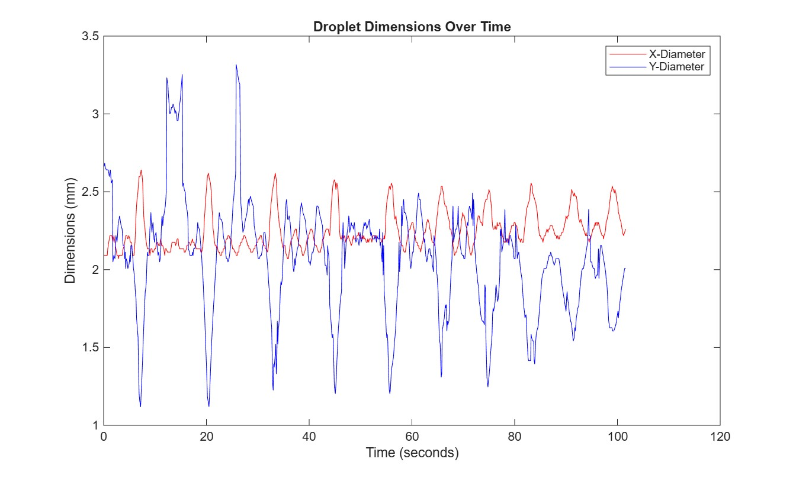
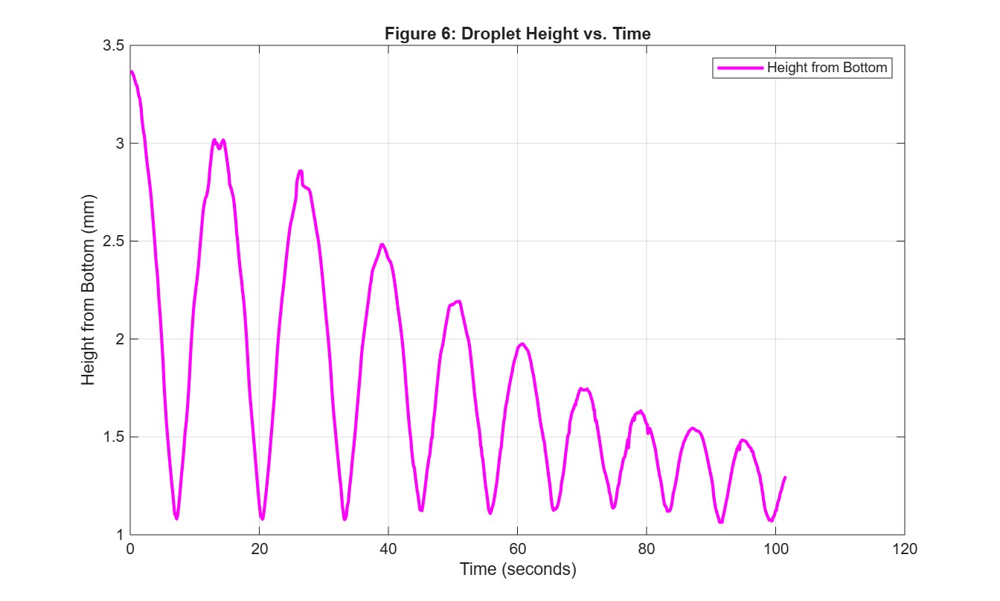

# Droplet Impact & Bounce Dynamics — Single-Camera Image Metrology in MATLAB

A MATLAB image-processing pipeline that turns a high-speed video of a water droplet hitting a **superhydrophobic surface** into measurements: diameters, centroid trajectory, rebound cycles, energy lost on impact, and a **3D volume reconstructed from a single 2D camera view**.

> Course project — ME3101, IIT Patna (Autumn 2026)

<p align="center">
  
  
</p>
<p align="center">
  
</p>

---

## Key Results

| Quantity | Value |
|---|---|
| Rebound cycles detected (top-boundary peaks) | **9** |
| Mechanical energy lost on first impact | **17.4 %** |
| Coefficient of restitution (first impact) | **≈ 0.91** |
| Max spreading diameter (first impact) | **2.64 mm** (spreading ratio ≈ 1.21) |
| Min height at max compression | **1.12 mm** (≈ 51 % of equivalent sphere diameter) |
| Resting centroid height above surface | **1.01 mm** |
| Reconstructed volume — bouncing vs. settled | **5.41 vs. 5.22 mm³** (3.5 % difference) |
| Volume-estimation error vs. sphere assumption | **56 % lower** (±13.5 % vs. ±30.6 %) |

---

## The Interesting Problem: Volume From One Camera

Water is incompressible, so the droplet's volume should stay constant. But one camera only sees a 2D silhouette, so the hidden depth has to be assumed. I tested three methods:

| Method | Assumption | Volume swing about mean |
|---|---|---|
| Spheroid formula $V = \frac{\pi}{6}x^2y$ | Depth equals horizontal diameter | Large spikes on impact |
| Area-equivalent sphere $r=\sqrt{A/\pi}$, $V=\frac{4}{3}\pi r^3$ | Every frame is a sphere | **±30.6 %** |
| **Pappus–Guldinus (adopted)** | Droplet is axisymmetric about its vertical axis | **±13.5 %** |

**Pappus–Guldinus approach.** Split the binary mask at the centroid's vertical axis. Revolving each half-silhouette about that axis gives

$$V = 2\pi\,\bar{r}\,A_{\text{half}}$$

where $A_{\text{half}}$ is the half-profile area (pixel count) and $\bar{r}$ is that half's centroid distance from the axis. Left and right halves are computed separately and averaged to cancel small lateral asymmetry. Because it follows the *measured* boundary, it handles both flattened (oblate) and stretched (prolate) shapes without a fixed shape factor.

<p align="center">
  
</p>

---

## Pipeline

```
Video frames ─► Grayscale ─► Background subtraction ─► Threshold ─► Morphological cleanup ─► regionprops
                              (imabsdiff vs frame 30)   (diff > 50)  (imclose disk 25,          (area, bbox,
                                                                      imfill, bwareafilt)        centroid, halves)
```

1. **Preprocessing:** frames converted to grayscale. Frame 30 is the background reference, because there the droplet, nozzle and substrate are fully separated. The droplet's rows are blanked out of the reference.
2. **Segmentation:** absolute difference against the reference, thresholded into a binary mask.
3. **Morphological cleanup:** `imclose` with a radius-25 disk bridges boundary breaks caused by internal light reflections. `imfill` makes the droplet solid. `bwareafilt` keeps only the largest object.
4. **Feature extraction:** `regionprops` gives the bounding box (x/y diameters, top/bottom edges), centroid and area, plus left/right half-masks for the volume reconstruction.
5. **Calibration:** Otsu thresholding on the bottom third of frame 1 isolates the substrate. Its pixel width, against a known 15 mm, gives the mm/pixel factor.
6. **Rebound detection:** boundaries smoothed with a 15-frame Gaussian window, then `findpeaks` (prominence 0.5 mm) on the top boundary.

### Key engineering decisions
- **Threshold choice:** values from 10–50 were tested. Higher values give clean edges in free fall, while thin, semi-transparent walls during impact favour lower values.
- **Structuring element:** disk radii of 10–25 were tested. Only radius 25 reliably fused the fragmented boundary of a deformed droplet.
- **Top boundary for peak detection:** reflections off the aluminium substrate cause 1-px jitter on the bottom edge, which triggers false peaks.

---

## Results Gallery

| Diameters over time | Centroid height over time |
|---|---|
|  |  |

The x/y diameters diverge sharply at each impact: the droplet flattens into an oblate disc, then stretches into a prolate shape on rebound. The centroid height shows decaying rebounds as viscous dissipation and contact-line friction remove energy.

---

## Limitations (and what I'd do next)

- **Playback time, not real time.** The supplied clip is a slowed-down export (10 fps, ~102 s), so time axes show playback seconds. Physical rates need the original capture frame rate.
- **Rebound vs. surface oscillation.** Peaks are counted on the top boundary. Later cycles include oscillations where the droplet may not fully lift off, and the bottom boundary separates the two.
- **Calibration** relies on the substrate's known 15 mm width. The substrate touches the frame edge, so the result depends on that reference.
- **2D projection.** Revolving a 2D profile can't capture non-axisymmetric 3D shapes during violent deformation. Out-of-plane drift also defocuses edges.

**Future work:** adaptive (Otsu) thresholding with a dynamic ROI, an orthogonal dual-camera setup for true 3D reconstruction, and learned segmentation (CNN / k-means) for faint liquid walls.

---

## Repository Structure

```
├── Code/
│   ├── FinalProject.m        # Full pipeline (script)
│   ├── FinalProject.mlx      # Same pipeline as a Live Script, with saved outputs
│   ├── sample.mp4            # Input high-speed video (800×512)
│   ├── calibration.png       # Reference photograph with scale bar
│   └── Picture1.png
├── Figure/                   # Figures 1–7 used in the report
└── Report/
    └── Project_Report.pdf    # Full methodology, analysis and discussion
```

## How to Run

**Requirements:** MATLAB (developed on R2026a) + Image Processing Toolbox + Signal Processing Toolbox (`findpeaks`).

```matlab
cd Code
FinalProject        % or open FinalProject.mlx and Run All
```

The script prints the calibration factor, the volume reports, the rebound count and the key results to the Command Window, and generates all plots.

> Note: the script loads the full video into memory (~2 GB peak). Close other heavy applications first.

---

## Author

**Arush Patel** — B.Tech Mechanical Engineering, IIT Patna
GitHub: [@SoULExtINcT](https://github.com/SoULExtINcT)

See [`Report/Project_Report.pdf`](Report/Project_Report.pdf) for the full write-up.
